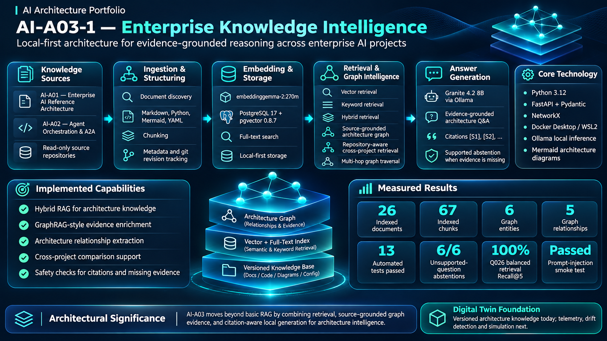
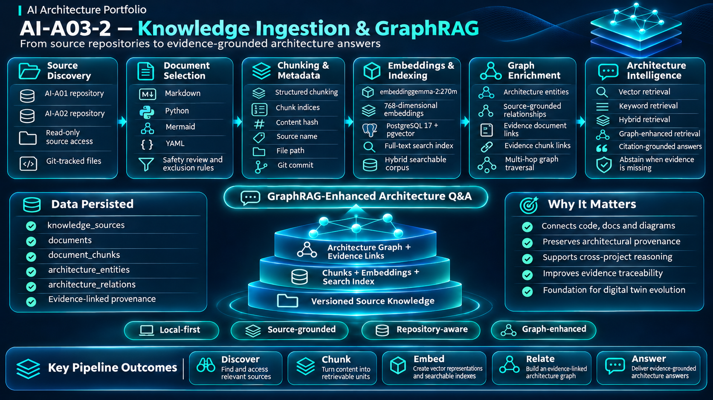

# AI-A03 — Enterprise Knowledge Intelligence

**Hybrid RAG · GraphRAG · Architecture Intelligence**

A local-first AI architecture intelligence prototype that combines semantic retrieval, full-text search, an evidence-backed knowledge graph, and local LLM inference to answer architecture questions with source citations.

## Architecture Overview

### Architecture Pipeline

1. **Knowledge Sources:** AI-A01 Enterprise AI Reference Architecture and AI-A02 Agent Orchestration & A2A.
2. **Ingestion:** Read-only Git-aware document discovery, content hashing and chunking.
3. **Embeddings and Storage:** Ollama embeddinggemma-2:270m, PostgreSQL 17 and pgvector.
4. **Retrieval:** Vector search, keyword search, Reciprocal Rank Fusion and repository filtering.
5. **Architecture Knowledge Graph:** Source-backed architectural relationships and NetworkX graph traversal.
6. **Answer Generation:** Granite 4.2 8B with evidence-grounded answers and citations.
7. **Evaluation:** Retrieval benchmarking, automated regression tests, abstention and security smoke tests.

## Knowledge Ingestion and GraphRAG

### Implemented Capabilities

- Ingestion of 26 approved architecture documents from AI-A01 and AI-A02.
- Storage and retrieval of 67 embedded document chunks.
- Vector, keyword and hybrid retrieval.
- Repository-aware cross-project retrieval.
- Source-grounded architecture knowledge graph with 6 entities and 5 relationships.
- Evidence-backed two-hop graph traversal.
- Natural-language architecture question answering.
- Source citation-identifier checks and basic missing-evidence handling.

## Technology Stack

| Component | Technology |
|---|---|
| Language | Python 3.12 |
| Database | PostgreSQL 17, pgvector 0.8.7 |
| Embeddings | embeddinggemma-2:270m |
| Generation model | Granite 4.2 8B |
| Local inference | Ollama |
| Architecture graph | NetworkX |
| Retrieval | PostgreSQL full-text search, vector search and RRF |
| Development | Ubuntu WSL2, Docker |
| Testing | pytest, Ruff |

## Measured Evaluation Results

The retrieval benchmark used 34 answerable questions from a 40-question dataset.

| Retrieval method | Top-1 | Recall@5 |
|---|---:|---:|
| Vector | 44.12% | 82.35% |
| Hybrid | 32.35% | 63.24% |
| Keyword | 17.65% | 47.06% |

Additional validation:

- **13 automated tests passed.**
- **6/6 unsupported-question tests successfully abstained.**
- One simulated prompt-injection test passed.
- Balanced project-aware retrieval improved Q026 expected-source Recall@5 from 0% to 100%, using manually specified subquestions.

The benchmark uses provisional source-relevance labels. These metrics do not represent independently validated factual answer accuracy.

## Running AI-A03

Start PostgreSQL:

`docker compose up -d`

Ingest approved Markdown sources:

`python -m src.ingestion.persist --scope markdown --max-documents 100`

Ask an architecture question:

`python -m scripts.ask_architecture "How is governance implemented in AI-A02?"`

Inspect the architectural graph:

`python -m scripts.inspect_graph`

Run tests:

`python -m pytest -q`

Run the retrieval benchmark:

`python -m evaluation.benchmark_retrieval --all`

The local Ollama service, embedding and generation models, database migrations, and configured read-only source repositories must be available.

## Architecture Diagrams

- [System Context](diagrams/01-system-context.mmd)
- [Container Architecture](diagrams/02-container-architecture.mmd)
- [Knowledge Ingestion](diagrams/03-knowledge-ingestion.mmd)
- [Hybrid RAG + GraphRAG](diagrams/04-hybrid-graphrag-retrieval.mmd)

## Documentation

- [Architecture Specification](docs/AI-A03-Architecture-Specification.md)
- [Architecture Decision Records](docs/adr/)
- [From Exploration to Production — RTX 4090 Roadmap](docs/AI-A03-From-Exploration-to-Production.md)

## Limitations and Future Work

AI-A03 is an engineering proof of concept, not a production-ready knowledge platform.

Current limitations include a curated graph, manually formulated cross-project subquestions, provisional benchmark labels, and incomplete claim-level citation verification.

Future architecture development may include automatic query decomposition, expanded source ingestion, architecture drift detection, operational telemetry, and Architectural Digital Twin capabilities.

## Portfolio

**AI Architecture Portfolio**

- AI-A01 — Enterprise AI Reference Architecture
- AI-A02 — Agent Orchestration & A2A
- AI-A03 — Enterprise Knowledge Intelligence

## License

No license selected yet.